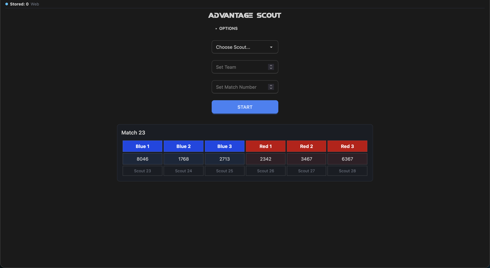

# Advantage Scout 2

Advantage Scout 2 is the new major version of our electronic scouting system [Advantage Scout](https://github.com/Mechanical-Advantage/AdvantageScout). The app consists of a Svelte5 frontend with a python FastAPI server. Bluetooth Low-Energy is used to communicate with the Android tablets. In this version, the scouting laptop acts as the peripheral that the tablets (clients) connect to.



## Setup

### Prerequisites:

- Node.js 20+
- Python 3.11+
- For Android builds: Android SDK (`ANDROID_HOME` set) and **JDK 21**

After cloning this repository, run the setup script under `scripts/`. Use the setup `.sh` for macOS/Linux, or the `.bat` file for Windows. Alternatively, complete the following steps to have a working environment for the app.

After seting up the project, obtain the `.env` for the necessary keys to run the full app.

### Linux/macOS Setup

```bash
# Install JS dependencies
npm install

# Create a python virtual environment
# Use python3 if on macOS
python -m venv .venv

# Activate the environment
source .venv/bin/activate

# Install Python requirements
pip install -r requirements/requirements-[your-os].txt

# Create the database directory
mkdir data

# Initialize the global database
python server/global_init.py

# Generate the Match and other databases by starting up the server
python server/http_server.py --regen-db
```

### Windows Setup

```powershell
# Install JS dependencies
npm install

# Create a Python virtual environment
python -m venv .venv

# Activate the environment (PowerShell)
.\.venv\Scripts\Activate.ps1

# Install Python requirements
pip install -r requirements/requirements-windows.txt

# Create the database directory
mkdir data

# Initialize the global database
python server/global_init.py

# Generate the Match and other databases by starting up the server
python server/http_server.py --regen-db
```

## Running the Server

To run the vite dev server `http://127.0.0.1:5173` with the http server `http://127.0.0.1:6328`:

```bash
npm run dev:web
```

To run the http server alone:

```bash
npm run web
```

or

```bash
python server/http_server.py --reload
```

To run the BLE bridge:

```bash
npm run bridge
```

or

```bash
python server/bluetooth_server.py --base-url http://127.0.0.1:6328
```

To run the full server (http and BLE):

```bash
npm run full
```

## Building the app

You will need the Android SDK installed along with environment variables `JAVA_HOME` and `ANDROID_HOME` set in order to build for Android.

To build:

```bash
npm run build

# For building Android
npx cap sync android
```

To build/install for Android:

```bash
npm run android:build
npm run android:install
```

or

```bash
# Build Android
npm run build
npm run cap:sync
cd android
./gradlew assembleDebug

# Install on device
adb install -r app/build/outputs/apk/debug/app-debug.apk
```
